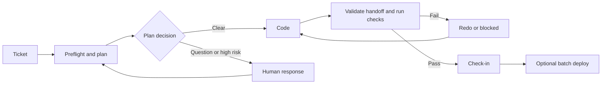

# Agent Pipeline

Understand an existing codebase, keep team knowledge current, and guide AI coding agents from a ticket through planning, implementation and QA.

**Project Brain** creates reusable architecture and code knowledge with source evidence, developer decisions and lessons. **The pipeline** coordinates your coding agent, tracker, tests and version control, one coding ticket at a time.

Built with Node.js built-ins and zero npm dependencies. **Developer preview:** Project Brain Milestones 1 and 2 are implemented; public-beta and production readiness are not established. See [release readiness](docs/product/RELEASE-READINESS.md) for tested workflows and remaining checks.

[Quick start](#quick-start-analyse-an-existing-project) · [Team workflows](#keep-project-knowledge-current) · [Ticket automation](#run-your-first-ticket) · [Limitations](#current-status-and-limitations) · [Documentation](#documentation)

## Who this helps

- **Developers joining an unfamiliar project:** investigate architecture, entry points, business rules and validation gaps, with links back to source.
- **Teams maintaining legacy applications:** start with one module, record constraints and preserve the reasons behind design decisions.
- **Maintainers using AI coding tools:** supply relevant feature docs and lessons, validate agent handoffs, and run configured checks before check-in.

For example, a new developer reviewing billing can trace its flow, ask the team why it shares an order transaction, record that decision, and later refresh findings after the implementation changes. This supports an architecture review; it does not certify clean architecture or readiness to scale.

## What you can do today

| Need | Available capability |
| --- | --- |
| Understand a project or module | Eight guided analysis stages covering overview, architecture, flows, business rules, integrations, patterns, risks and validation |
| Check where a claim came from | Findings with source hashes, line references, certainty, verification notes and explicit unknowns |
| Detect outdated knowledge | On-demand checks for changed or deleted evidence, including edits made outside the pipeline |
| Update only selected findings | Refresh runs with revisions, retirement and preserved historical records |
| Preserve team reasoning | Scoped, attributed decisions with rationale and supersession |
| Resolve disagreements | Explicit conflicts with both positions, ownership, resolution and reopening history |
| Maintain useful lessons | Applicability, evidence checks, duplicate review, corrections and retirement |
| Deliver ticket work | Planning, handoff validation, build/test gates, scripted QA, check-in and optional batch deployment |

The static index includes selected web-file relationships and heuristic .NET analysis. Deeper interpretation comes from your coding agent and developer review.

## Quick start: analyse an existing project

### 1. Install from source

You need Node.js 18.17+ and npm. Git is needed for the clone command.

```sh
git clone https://github.com/hirpararajesh99/agent-pipeline.git
cd agent-pipeline
npm link
agent-pipeline help
```

This links your local checkout as the `agent-pipeline` command. The instructions use source installation and do not depend on a published npm release. In Windows PowerShell, use `npm.cmd` if script policy prevents running `npm`.

You can also invoke the source directly: `node /absolute/path/to/agent-pipeline/bin/pipeline.mjs help`. On Windows, for example: `node D:\Code\agent-pipeline\bin\pipeline.mjs help`.

### 2. Prepare an analysis

Open a terminal in a copy or checkout of the project you want to understand. Replace the example path with yours:

```sh
cd /path/to/your-project
agent-pipeline brain init --name first-look --scope .
agent-pipeline brain status --name first-look
```

Replace `.` with a real module path such as `src/Billing` for a smaller investigation. Bootstrap creates an inventory, initial context and ordered analysis prompts under `.project-brain/runs/first-look/`.

**Standalone Brain analysis does not require `agent-pipeline init`, a tracker or a QA script.** If `pipeline.config.json` exists, it is loaded and validated; `--config` selects a different configuration. Without configuration, the current directory is the workspace.

These two commands prepare the work; they do not invoke an AI provider or complete the architecture analysis.

### 3. Choose how to run the analysis

**Use your existing coding-agent session:** open the `prompt` file reported by `brain status` and give it to the agent in the target project. You can say:

> Follow the instructions in the reported prompt file. Inspect the actual source, record evidence and unknowns, and write only the requested submission.

After the agent writes the JSON submission:

```sh
agent-pipeline brain analyze --name first-look
```

This validates one stage, renders its findings and reports the next prompt. Repeat the prompt/submission/acceptance cycle through stage 08.

**Or automate the remaining stages:** with the provider CLI installed and authenticated:

```sh
agent-pipeline brain run --name first-look
```

Without configuration, this uses the built-in Codex preset. With configuration, `agent.brain` overrides the main `agent` settings. Provider usage charges may apply. A failed stage stops the run; retrying retains accepted stages.

`brain init/status/analyze` do not invoke a provider themselves. Your external agent performs the analysis. Use its permissions to constrain execution: snapshot checks detect covered file changes after they occur and are not an execution sandbox.

### 4. Read the result

After all eight stages complete, open:

```text
.project-brain/runs/first-look/ai-analysis/final-context.md
```

The synthesis links to detailed stage findings and lists unknowns and limitations. A simplified, illustrative finding might read:

| Field | Example |
| --- | --- |
| Statement | Billing writes an outbox record inside the order transaction |
| Certainty | Inferred |
| Evidence | `src/Billing/CheckoutService.cs`, cited lines and recorded SHA-256 |
| Verification | Read the transaction and outbox calls; runtime behavior not tested |
| Unknown | Whether the delivery worker can produce duplicate external requests |

Actual findings depend on your project and the agent's evidence. The validator checks structure and evidence references; a person still reviews the claim.

A run's main outputs are:

```text
.project-brain/runs/first-look/
  RUN-ANALYSIS.md          Instructions for this run
  project-context.md      Initial project context
  knowledge/project.json  Inventory, scope and snapshot
  prompts/                Eight ordered prompts
  submissions/            Agent submissions
  ai-analysis/            Accepted findings and final-context.md
```

Use [the full Brain guide](docs/features/project-brain/README.md) for submission formats, snapshot exclusions and recovery. If source changes during analysis, acceptance is blocked; investigate the changes and start a new named run when necessary.

## Keep project knowledge current

### Check freshness after code changes

```sh
agent-pipeline brain freshness --name first-look
```

The JSON report lists source changes and accepted findings as `current`, `stale` or `unchecked`. Certainty is tracked separately. Matching cited bytes does not prove semantic validity; uncited changes still need review. Use this command after source edits; `brain status` enforces the original snapshot.

### Refresh affected findings

Prepare a new run using an existing run's stale findings:

```sh
agent-pipeline brain refresh --name first-look --to first-look-r2
```

Give the reported prompt to your coding agent. After it writes the refresh submission, inspect it and accept it:

```sh
agent-pipeline brain refresh --name first-look-r2 --accept
agent-pipeline brain freshness --name first-look-r2
```

The new run contains `knowledge/findings.json` and `ai-analysis/refresh.md`. Earlier runs and unselected finding revisions remain available. Use the latest accepted run as the source for later refreshes.

To choose a batch, add `--findings 01-example,02-example` during preparation, replacing those examples with actual finding IDs. Omitted stale findings remain stale. Refresh revises or retires existing findings; use a new analysis for new findings or a different scope.

Refresh commands do not invoke AI, and `brain run` does not process refresh runs. See [selective refresh and recovery](docs/features/project-brain/README.md#selective-refresh-and-revision-history).

### Preserve decisions and resolve conflicts

```sh
agent-pipeline brain decision add --id billing-local --scope src/Billing --by Rajesh --statement "Keep billing in the application" --reason "Preserve the order transaction"
agent-pipeline brain knowledge --scope src/Billing
```

Use a new decision ID with `--supersedes` to change a decision while retaining earlier reasoning. Conflicts explicitly record both positions:

```sh
agent-pipeline brain conflict add --id billing-boundary --scope src/Billing --by Rajesh --owner Priya --summary "Billing boundary disagreement" --left "Code uses direct calls" --right "Proposed design uses a service"
agent-pipeline brain conflict resolve --id billing-boundary --by Priya --resolution "Keep direct calls for now" --reason "The service design needs transaction validation" --decision billing-local
```

New refreshes capture relevant decisions and conflicts. Acceptance requires no open relevant conflicts and unchanged captured review context. Resolving a conflict after preparation requires a new target run. Attribution uses caller-supplied names, not authenticated identities.

See the [developer review guide](docs/features/project-brain/REVIEW.md) for ownership, reopening, references and history.

### Review lessons instead of accumulating outdated advice

```sh
agent-pipeline brain lesson list
agent-pipeline brain lesson duplicates
```

For a file returned by `list`, use `brain lesson review` to record scope, applicability, evidence and rationale. Use `correct` to replace its effective rule, `duplicate` to record a reviewed duplicate, or `retire` to stop using it.

Ticket prompts use effective corrections and exclude retired, duplicate and stale reviewed lessons. Legacy lessons remain eligible as explicitly unreviewed guidance. Earlier revisions and original Markdown are preserved.

See the [lesson lifecycle walkthrough](docs/features/project-brain/LESSONS.md) for runnable review/correction examples and limits.

## Run your first ticket

Ticket automation needs a configured coding agent, tracker and real QA command. Start with a small change in a disposable checkout, inspect the plan, then inspect the resulting diff and application.



For a high-risk plan, a person may approve it directly to coding; changed requirements return to planning.

### Configure the target project

From the target project's root:

```sh
agent-pipeline init
```

This seeds `pipeline.config.json`, `AGENTS.md`, `jobs/`, `docs/` and `tickets.json`, keeping existing files. Shared project instructions belong in `AGENTS.md`; check that your chosen agent loads them.

Edit the generated configuration before running a ticket:

| Setting | What to configure |
| --- | --- |
| `agent.provider` | An installed, authenticated provider: built-in presets are `codex`, `claude`, `cursor`; custom commands are supported |
| `tracker` | Local `tickets.json` or a configured ClickUp list |
| `vcs.type` | `none` for a disposable pilot, `git` for Git check-in, or `command` for a custom VCS |
| `gates.build`, `gates.unitTests` | Your project's build/test commands; blank entries skip those gates |
| `qa.command` | A real QA script or command; the generated example path must be implemented or replaced |
| `deploy.command`, `deploy.smokeCommand` | Optional deployment checks; leave deployment disabled for the first pilot |

QA defaults are exit `0` for pass, `2` for fail and `3` for environment blocked. An always-successful placeholder does not validate the application. With `vcs.type: "none"`, edits happen in the configured workspace and there is no VCS commit.

Check setup and block the sample ticket before adding real work:

```sh
agent-pipeline doctor
agent-pipeline ticket set DEMO-1 blocked
```

The sample is created only when `tickets.json` did not already exist. If your file has no `DEMO-1`, skip that command. `doctor` checks setup; it does not establish that your QA script exercises the right behavior.

### Add, plan and implement a small change

```sh
agent-pipeline ticket add --id WEB-1 --title "Replace header logo" --description "Replace the header logo with assets/company-logo.png. It must appear on desktop and mobile. Preserve navigation, layout, colours and text."
agent-pipeline run --dry-run
agent-pipeline run --job plan
agent-pipeline ticket show WEB-1
```

Review scope, files, acceptance checks and risks before running coding:

```sh
agent-pipeline run --job code
agent-pipeline ticket show WEB-1
```

Each tick may select other eligible tickets; the first pilot should have only the intended ticket eligible. Clear plans become ready automatically. Plans requiring information or approval wait for a human action.

The pipeline validates handoff files, listed paths, acceptance-check QA coverage and documentation updates, then runs configured checks before check-in. Failed attempts carry evidence into retries; the default maximum is three.

### Respond to questions and failures

| Situation | Action |
| --- | --- |
| `need info` | Add a `ticket comment`, then `ticket set ID resume` to re-plan |
| `needs approval` | Inspect the high-risk plan; `ticket set ID ready` approves coding |
| Requirements changed | Comment with the new scope, then set `resume` |
| A defect is found | Comment with reproduction details, then set `redo`; a lesson is required |
| Repeated failures or environment blockage | Inspect the failure and working tree, fix the cause, then set `resume` or `ready` as appropriate |

```sh
agent-pipeline ticket comment WEB-1 "Use the approved transparent PNG and preserve its aspect ratio."
agent-pipeline ticket set WEB-1 resume
agent-pipeline run --job plan
```

Default progress is `not started → planning → code ready → in development → development completed → ai testing → ai test pass`, then `sign off` after configured deployment. Status names can be mapped under `tracker.statuses`; ClickUp lists need the configured statuses.

## Configuration and daily operation

### Find relevant project context

These commands use `pipeline.config.json` and do not invoke AI:

```sh
agent-pipeline docs scan
agent-pipeline docs impact assets/company-logo.png
agent-pipeline docs find "widget list needs a search box"
agent-pipeline docs index
```

The index maps selected file relationships, including .NET project references, code-behind, namespaces/types and some routes/DI patterns. Feature selection uses keywords and paths. Lessons are filtered for review state and applicability. This is bounded heuristic retrieval; measured token budgets and graph expansion are Milestone 3 work.

| Project path | Purpose |
| --- | --- |
| `docs/project-index.json`, `docs/project-graph.json`, `docs/PROJECT-INDEX.md` | Generated file inventory and relationships |
| `docs/features/<feature>/README.md` | Current behavior; front matter supplies title, keywords and paths |
| `docs/features/<feature>/tickets/` and `CHANGELOG.md` | Ticket plans and change history |
| `docs/memory/INDEX.md` and `docs/memory/lessons/` | Indexed lessons from redo work |
| `.project-brain/runs/` | Analysis and refresh runs |
| `.project-brain/review/records.json` | Developer decision/conflict history |
| `.project-brain/lessons/records.json` | Lesson review and revision history |

Existing feature documentation is reused. When a feature has no README, the planning workflow can describe current behavior and seed one. Future tasks still require source inspection.

### Select providers and integrations

Use `agent.provider` for coding, `agent.plan` for planning overrides, and `agent.brain` for automated analysis overrides. Presets live in [the agent adapter](src/adapters/agents/index.mjs); custom command/argument overrides live under `agent.providers.<name>`. Match the preset to your installed CLI's supported arguments.

Supported adapters are file/ClickUp trackers and Git/custom-command/no-op VCS. The [enterprise example](templates/examples/enterprise-tfvc.config.json) illustrates TFVC and ClickUp configuration; it requires your own tools, credentials and QA/deployment commands.

See [the starter configuration](templates/pipeline.config.example.json) and [all defaults](src/config.mjs). `--config PATH` or `PIPELINE_CONFIG` selects a configuration. Review configured Git push/PR and deployment behavior before enabling them.

### Dashboard and scheduling

```sh
agent-pipeline serve --port 3000
agent-pipeline status
```

The dashboard at `http://localhost:3000` is a local operator view. It is not yet a Project Brain knowledge browser. It has state-changing operations and no authentication; keep it local. Use `ticket show ID` for the saved ticket and plan.

After proving a workflow, start with scheduled planning:

```sh
agent-pipeline loop --job plan --interval 15
```

`agent-pipeline loop --interval 15` runs the full scheduler. Task Scheduler, cron or another scheduler can also run individual ticks. Separate plan/code locks coordinate jobs; coding remains one ticket at a time.

## Current status and limitations

| Area | Status |
| --- | --- |
| Milestone 1: bootstrap and guided analysis | Implemented |
| Milestone 2: freshness, refresh, decisions/conflicts and lesson lifecycle | Implemented |
| Milestone 3: explainable context and incremental analysis | Next |
| Milestone 4: measured legacy/modern .NET pilot | Planned |
| Milestone 5: broader access and adoption | Planned |

Local validation includes 87 passing tests on Windows with Node 24.22.1 and offline package/CLI smoke checks. The suite uses fake agents and local fixtures. The declared Node 18.17 minimum, macOS/Linux, real AI providers, ClickUp, Git remotes, TFVC and deployment still need release validation.

Important boundaries:

- Findings and matching evidence hashes need human interpretation. Static relationships are incomplete; dynamic behavior, performance and scaling require further investigation.
- Accepted Brain findings and developer decisions are not yet automatically selected into everyday ticket prompts with an explainable budget. Existing feature/index/lesson retrieval is available.
- Snapshot and artifact checks detect covered changes and malformed output; they do not sandbox agents. Agent permissions control execution.
- Review names are caller-supplied. Local hash-linked history is not authenticated or tamper-proof storage.
- Credential filtering and display redaction are best-effort. Keep secrets out of prompts and knowledge; external agents may send inspected content to their providers.
- Time savings, token savings and fewer defects have not been measured. Completing milestones does not establish production readiness.

See [release readiness](docs/product/RELEASE-READINESS.md) and [Brain guard boundaries](docs/features/project-brain/README.md) before adopting the preview.

## How it fits your existing tools

| Tool | Its role | Agent Pipeline's role |
| --- | --- | --- |
| Coding agent | Reads and changes code | Provides jobs/context and validates handoffs |
| Ticket tracker | Stores work and discussion | Selects eligible work and updates configured statuses |
| Build, test and CI tools | Execute project checks | Calls configured commands and handles their outcomes |
| Version control | Stores changes and history | Prepares workspaces and performs configured check-in |
| Project documentation | Explains the system | Adds evidence, freshness checks, decisions and reviewed lessons |

## Documentation

- [Project Brain guide](docs/features/project-brain/README.md): analysis, refresh, evidence formats and recovery.
- [Developer review guide](docs/features/project-brain/REVIEW.md): decisions, conflicts, attribution and history.
- [Lesson lifecycle](docs/features/project-brain/LESSONS.md): applicability, duplicates, corrections and retirement.
- [Product overview](PRODUCT.md), [vision](docs/product/PROJECT-BRAIN.md), [architecture](docs/product/ARCHITECTURE.md) and [roadmap](docs/product/ROADMAP.md).
- [Release readiness](docs/product/RELEASE-READINESS.md) and [changelog](CHANGELOG.md).
- [Contributing](CONTRIBUTING.md) and [repository agent instructions](AGENTS.md).

For contributors, run the offline regression suite from this repository:

```sh
npm test
```

No real AI account or network is required for these tests. Use `agent-pipeline help` for the full CLI command list.

## License

[MIT](LICENSE).
